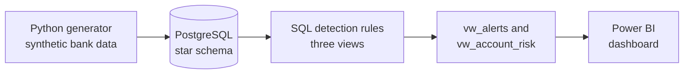
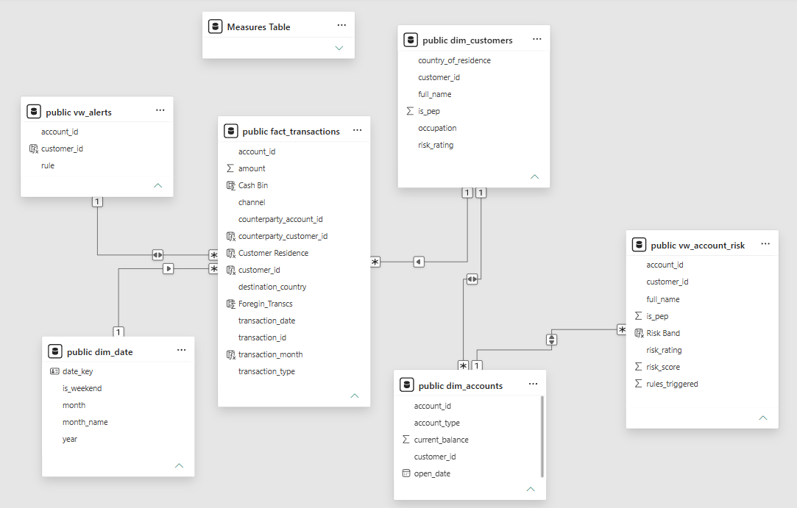
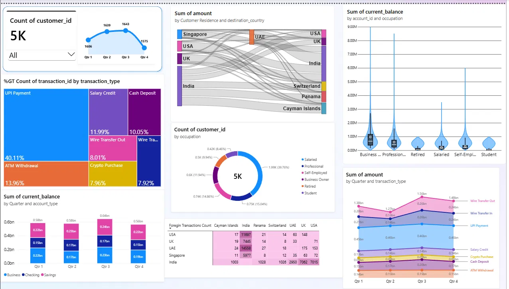
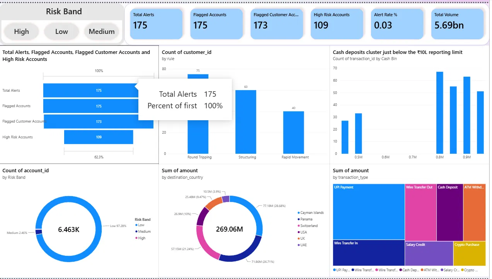
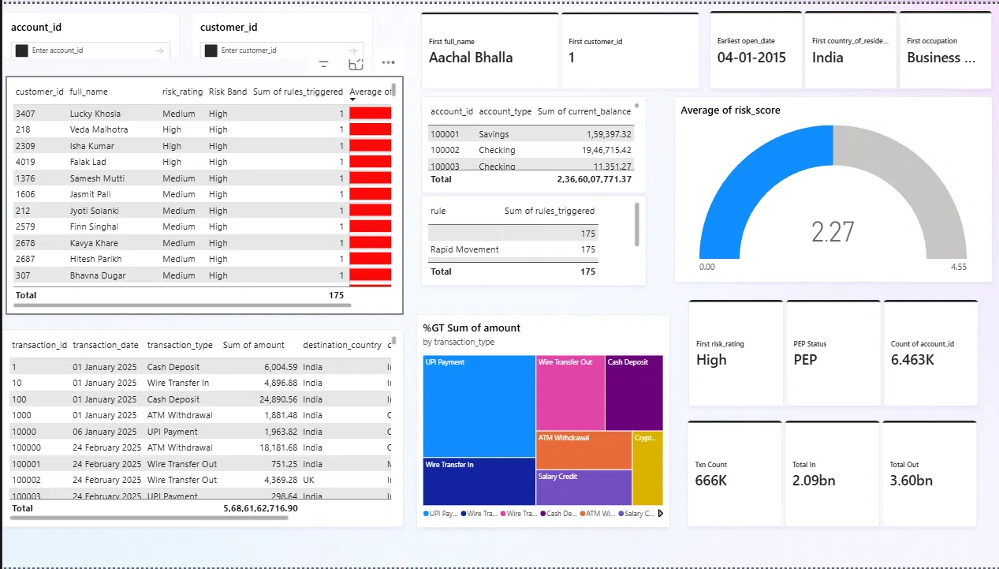

# AML Transaction Monitoring & Risk Analytics

An end-to-end Anti-Money Laundering (AML) monitoring prototype built on a **synthetic banking dataset**: Python generates the data, PostgreSQL detects suspicious patterns with SQL rules, and Power BI turns the results into a three-page dashboard.

**Tools:** Python (pandas, NumPy, Faker) · PostgreSQL · Power BI (DAX, Power Query)

> **Note:** All data in this repository is synthetic. No real customers, accounts or transactions are used.


---

## Table of contents

1. [Business problem](#business-problem)
2. [What this project does](#what-this-project-does)
3. [Architecture](#architecture)
4. [The synthetic dataset](#the-synthetic-dataset)
5. [Data model](#data-model)
6. [Detection rules (SQL)](#detection-rules-sql)
7. [Risk scoring](#risk-scoring)
8. [Dashboard pages](#dashboard-pages)
9. [Key findings](#key-findings)
10. [Key DAX measures](#key-dax-measures)
11. [Skills demonstrated](#skills-demonstrated)
12. [How to run it](#how-to-run-it)
13. [Repository structure](#repository-structure)
14. [Limitations](#limitations)
15. [Possible improvements](#possible-improvements)


---

## Business problem

Banks are required to monitor customer transactions for money laundering and report suspicious activity to regulators. Failure to do so can lead to heavy fines. At the same time, compliance teams receive far more alerts than they can investigate, so they need to know:

- **How is the bank's activity distributed, and where does money flow?**
- **Which accounts are flagged, and how risky are they?**
- **What does the history of one specific customer or account look like?**

This project builds the monitoring and triage layer that answers those questions.

---

## What this project does

1. **Generates** a fake bank: 5,000 customers, 6,463 accounts and about 666,000 transactions for the year 2025.
2. **Plants** three money-laundering patterns, plus decoy accounts, inside normal activity.
3. **Detects** the patterns with SQL rules (window functions and self-joins) in PostgreSQL.
4. **Scores** every account by combining rule alerts with customer risk attributes.
5. **Visualises** everything in a three-page Power BI dashboard: **Overview**, **Risk Info** and **Accounts Info**.

---

## Architecture



| Stage | File | Output |
|---|---|---|
| 1. Generate data | `generator/generate_data.py` | 4 CSV files |
| 2. Load and detect | `sql/aml_pipeline.sql` | Tables, rule views, alert and risk views |
| 3. Visualise | `powerbi/AML_Dashboard.pbix` | Interactive three-page report |

---

## The synthetic dataset

The generator builds normal behaviour first, then injects suspicious patterns.

**Normal behaviour**
- Transaction counts per account follow a Poisson distribution (business accounts are busier).
- Amounts follow a log-normal distribution scaled to each customer's income, so most are small and a few are large.
- Cash deposits and ATM withdrawals are capped to realistic sizes.

**Planted suspicious patterns**

| Pattern | What was planted | Accounts |
|---|---|---|
| Structuring | 3-5 cash deposits at 80-99% of the ₹10 lakh reporting limit within 3 days | 60 |
| Rapid movement of funds | Large incoming wire, then 80-95% wired to a high-risk country within 2 days | 40 |
| Round tripping | Money moving A → B → C → A, shrinking about 1% per hop | 75 (25 rings) |

**Decoys:** 30 business accounts make two mid-size cash deposits (₹4.5-5.5 lakh) so that not every large deposit is a crime.

High-risk countries used: Cayman Islands, Panama, Switzerland.

---

## Data model



Star schema in Power BI. Some relationships are intentionally **inactive** to avoid ambiguous filter paths between tables.

| Table | Type | One row is... |
|---|---|---|
| `dim_customers` | Dimension | A customer |
| `dim_accounts` | Dimension | A bank account |
| `dim_date` | Dimension | A calendar day of 2025 |
| `fact_transactions` | Fact | A money movement |
| `vw_alerts` | SQL view | An account that triggered a rule |
| `vw_account_risk` | SQL view | An account with its risk score |

**Main IDs**

| ID | Identifies |
|---|---|
| `customer_id` | A person |
| `account_id` | A bank account (a customer has 1-2) |
| `transaction_id` | A single transaction |
| `counterparty_account_id` | The other account in a wire transfer |

**Columns added in Power BI**

| Column | Table | Purpose |
|---|---|---|
| `Customer Residence` | `fact_transactions` | Country of residence of the account owner |
| `customer_id` | `fact_transactions` | Owner of the account, looked up from `dim_accounts` |
| `counterparty_customer_id` | `fact_transactions` | Owner of the counterparty account |
| `transaction_month` | `fact_transactions` | Month of the transaction date |
| `Foreign_Transcs` | `fact_transactions` | 1 when destination country differs from residence |
| `Cash Bin` | `fact_transactions` | 50,000-rupee bucket for cash deposits (used for the structuring histogram) |
| `customer_id` | `vw_alerts` | Owner of the flagged account |
| `Risk Band` | `vw_account_risk` | Low, Medium or High label based on the risk score |

---

## Detection rules (SQL)

All rules live in `sql/aml_pipeline.sql` as views.

| Rule | Logic | SQL technique |
|---|---|---|
| **Structuring** | At least 3 cash deposits between ₹8L and ₹10L within a 3-day window, and the window total is ₹10L or more | `SUM() OVER (PARTITION BY ... RANGE INTERVAL)` window function |
| **Rapid movement** | Wire in of ₹10L or more, then 70% or more wired out to Cayman Islands, Panama or Switzerland within 2 days | Self-join on the same account |
| **Round tripping** | A pays B, B pays C, C pays A. Each hop within 7 days and 95-100% of the previous amount | Three-way self-join on counterparty |

`vw_alerts` stacks the three rule outputs into one table of (account, rule) pairs.

---

## Risk scoring

`vw_account_risk` gives every account a score. The rules decide who is flagged; the score helps decide who to look at first.

| Component | Points |
|---|---|
| Structuring alert | +40 |
| Rapid movement alert | +40 |
| Round tripping alert | +30 |
| Customer is a Politically Exposed Person (PEP) | +20 |
| Customer risk rating High | +10 |
| Customer risk rating Medium | +5 |

In Power BI, `Risk Band` groups the score into Low, Medium and High. The `High Risk Accounts` measure counts accounts with a score of 40 or more.

---

## Dashboard pages

### 1. Overview
The bank-wide picture of customers, accounts and transactions.

- Customer count with a quarterly trend and a dropdown slicer
- Transaction mix by type (treemap, share of total transactions)
- Transaction value by quarter and type (area chart)
- Account balances by quarter and account type (stacked column chart)
- Customers by occupation (donut chart) and balance distribution by occupation (violin plot)
- Sankey diagram of transaction amount flowing from customer residence to destination country
- Matrix of foreign transaction counts by customer residence and destination country



### 2. Risk Info
What did the detection rules find, and how risky is it?

- Risk Band slicer (High, Medium, Low)
- KPI cards: Total Alerts, Flagged Accounts, Flagged Customer Accounts, High Risk Accounts, Alert Rate %, Total Volume
- Alert funnel: total alerts → flagged accounts → flagged customer accounts → high-risk accounts
- Alerts by rule (Structuring, Rapid Movement, Round Tripping)
- Cash-deposit histogram by `Cash Bin`, showing the cluster just below the ₹10L reporting limit
- Accounts by risk band (donut chart)
- Transaction value by destination country (donut chart)
- Transaction value by type (treemap)



### 3. Accounts Info
Look up a single customer or account.

- Search boxes for `account_id` and `customer_id`
- Customer profile cards: name, customer ID, account open date, country of residence, occupation
- Customer table with risk rating, risk band, rules triggered and average risk score (data bars)
- Account table with account type and current balance
- Rules-triggered table
- Gauge for the average risk score
- Cards: risk rating, PEP status, number of accounts, transaction count, total in, total out
- Transaction detail table (ID, date, type, amount, destination country, channel)
- Transaction value by type (treemap)



---

## Key findings

These findings come from synthetic data in which the patterns were planted on purpose, so they show what the dashboard can surface, not what a real bank would see.

- The SQL rules raised **175 alerts** across **175 accounts**, about 2.7% of the 6,463 accounts. Each flagged account triggered exactly one rule.
- **109 accounts** are classed as high risk, so roughly 6 in 10 flagged accounts need priority attention.
- Alerts by rule: Round Tripping 75, Structuring 60, Rapid Movement 40.
- Cash deposits cluster between about ₹8L and ₹10L, just below the reporting limit.
- Among transactions to foreign countries, Cayman Islands, Panama and Switzerland together account for about 77% of the value.

---

## Key DAX measures

| Measure | Purpose |
|---|---|
| `Total Volume` | Sum of transaction amounts |
| `Txn Count` | Number of transactions |
| `Total Alerts` | Rows in `vw_alerts` |
| `Flagged Accounts` | Distinct accounts with at least one alert |
| `Flagged Customer Accounts` | Distinct customers who own a flagged account |
| `High Risk Accounts` | Accounts with a risk score of 40 or more |
| `Alert Rate %` | Flagged accounts divided by all accounts |
| `Total In` / `Total Out` | Credits and debits for the selected customer or account |
| `PEP Status` | "PEP" or "Not PEP" label for the selection |
| `Account Risk Score` | Risk score as a single value for the gauge |

---

## Skills demonstrated

| Area | What is shown |
|---|---|
| Python | Synthetic data generation, statistical distributions, reproducible random seed |
| SQL | Star-schema DDL, keys and indexes, `generate_series` date table, data-quality checks, CTEs, window functions, self-joins, views, `CASE` scoring |
| Power BI | Power Query typing, star-schema modelling, active and inactive relationships, DAX measures and calculated columns, custom visuals (Sankey, violin plot), funnel, gauge, treemap, area chart, conditional formatting, slicers |
| Domain | Structuring, rapid movement of funds, round tripping, PEPs, high-risk jurisdictions, alert prioritisation |

---

## How to run it

**Requirements:** Python 3.10+, PostgreSQL 12+, Power BI Desktop (Windows).

**1. Generate the data**
```bash
pip install -r requirements.txt
python generator/generate_data.py
```
This creates a `data/` folder with `customers.csv`, `accounts.csv`, `transactions.csv` and `ground_truth.csv`.

**2. Build the database**
1. In PostgreSQL, run `CREATE DATABASE aml_project;` and connect to it.
2. Run STEP 1 of `sql/aml_pipeline.sql` to create the tables.
3. From the repository root, in `psql`, run the four `\copy` lines in STEP 2.
4. Run the rest of the script: indexes, `dim_date`, quality checks, rule views, `vw_alerts` and `vw_account_risk`.

**3. Open the dashboard**
1. Open `powerbi/AML_Dashboard.pbix`.
2. Go to **Home → Transform data → Data source settings** and point the PostgreSQL connection to your server and the `aml_project` database.
3. Click **Refresh**.

The Sankey and violin plot are custom visuals, so Power BI may ask you to allow them on first open.

---

## Repository structure

```
.
AML-Transaction-Monitoring/
│
├── README.md
├── requirements.txt
├── .gitignore
├── LICENSE
│
├── generator/
│   └── Data generation.ipynb
│
├── sql/
│   └── AML_pipeline.sql
│
├── powerbi/
│   ├── AML_dashboard.pbip
│   ├── AML_dashboard.Report/
│   └── AML_dashboard.SemanticModel/
│
└── docs/
    └── images/
        ├── overview.png
        ├── risk_info.png
        ├── accounts_info.png
        └── data_model.png
```

---

## Limitations

This is a learning and portfolio project, not a production AML system.

- **The data is synthetic.** The suspicious patterns were planted by the same author who wrote the detection rules, so the rules finding the planted cases only confirms that the pipeline works as designed. It is not evidence of detection accuracy on real data.
- **Detection performance was not formally evaluated.** Precision and recall were deliberately left out of scope.
- **Rule-based only.** Real institutions combine rules with statistical or machine-learning models, case management systems and analyst feedback.
- **Customer risk rating is random** here. In a real bank it comes from onboarding checks and carries information.
- **`destination_country` defaults to India** for non-wire transactions, so `Foreign_Transcs` and the foreign-transaction matrix on the Overview page are only meaningful for outgoing wire and crypto transactions. Customers living outside India show large counts "to India" for this reason.
- **Thresholds are illustrative.** The ₹10 lakh limit, the 3-day window and the score weights are assumptions, not regulatory guidance.

---

## Possible improvements

- Add an `alert_date` to each rule to show alert trends over time.
- Restrict `Foreign_Transcs` to wire and crypto transactions so the foreign-transaction matrix is accurate.
- Make the synthetic crimes messier, with more variation and harder look-alike innocent accounts, then measure precision and recall.
- Add a What-if parameter for investigator capacity to show how many priority cases can be covered each week.
- Add anomaly detection (for example, unusual spending versus an account's own history).
- Apply Row-Level Security by region.

---


Feedback and suggestions are welcome.
